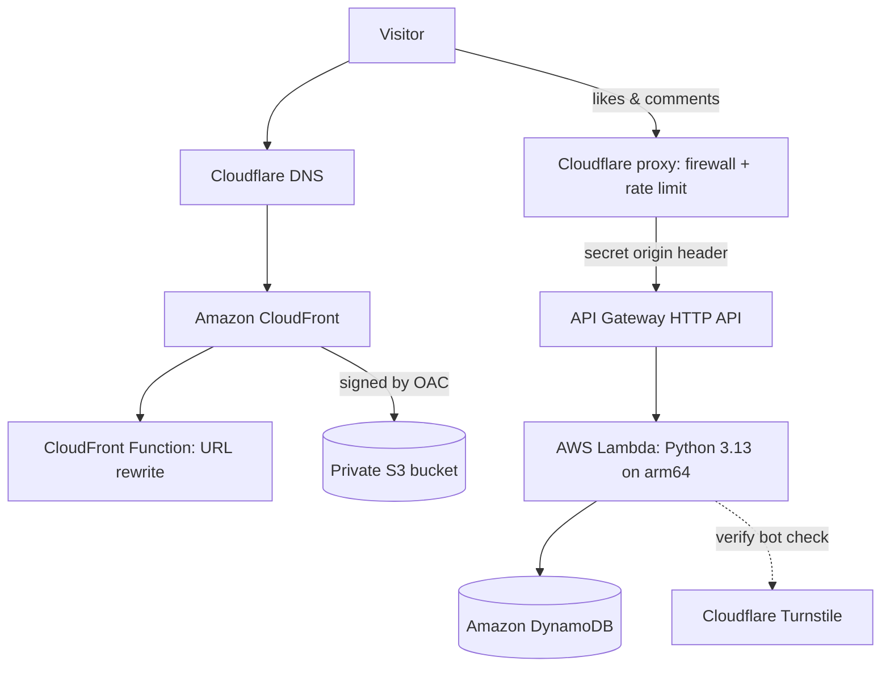
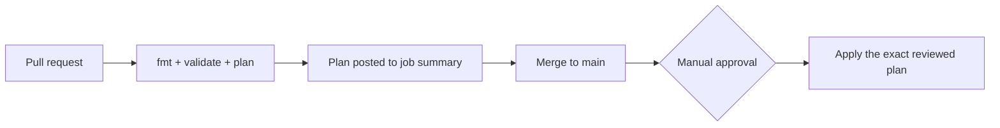
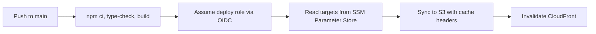

This website is a small but complete production system. The front end is a static TypeScript build, hosted on a private S3 bucket behind CloudFront. Likes and comments run on a serverless API. Every piece of infrastructure is defined in Terraform and deployed by GitHub Actions — without a single long-lived cloud credential.

The project is split across two repositories:

- **my-website**: the site itself (TypeScript, Markdown posts, styles) and its deploy workflow.
- **my-website-infra**: Terraform for everything the site runs on, plus the CI workflow that plans and applies it.

## Architecture overview



The site and its API live in the **ap-south-1 (Mumbai)** region, with the CloudFront certificate in **us-east-1**, as CloudFront requires.

## The front end

The site is built with **Vite and TypeScript** — no UI framework. A small typed DOM helper renders every page from content data, which keeps the JavaScript light and the pages fast.

- **Content as data**: articles are Markdown files with frontmatter. Listings, tags, reading time, related posts and the table of contents are all generated from them.
- **Generated artwork**: post covers and illustrations are SVG drawn in code, seeded by each post's slug — no stock or AI images.
- **Progressive loading**: the diagram library (Mermaid) is only downloaded when a page actually contains a diagram and it scrolls near the viewport.
- **Accessibility**: skip link, keyboard-friendly navigation, `prefers-reduced-motion` support and light/dark themes that follow the system setting without a flash on load.

## Hosting and delivery

```hcl
resource "aws_cloudfront_distribution" "site" {
  http_version        = "http2and3"
  default_root_object = "index.html"

  origin {
    domain_name              = aws_s3_bucket.site.bucket_regional_domain_name
    origin_access_control_id = aws_cloudfront_origin_access_control.site.id
  }
}
```

- **Private origin**: the S3 bucket is not public. CloudFront reads it using **Origin Access Control (OAC)** with SigV4-signed requests.
- **HTTPS everywhere**: HTTP redirects to HTTPS, with an ACM certificate and a minimum of TLS 1.2. HTTP/2, HTTP/3 and IPv6 are enabled.
- **Security headers**: added at the edge by CloudFront's managed security-headers policy.
- **Clean URLs**: a tiny CloudFront Function rewrites directory-style paths to their `index.html`, because a private S3 origin cannot do that itself.
- **DNS**: records are managed in Cloudflare by Terraform.

### Caching strategy

Built JavaScript and CSS files carry a content hash in their name, so they can be cached aggressively. HTML is always revalidated so new content appears immediately.

| Files | Cache-Control | Why |
| --- | --- | --- |
| `/assets/*` (hashed bundles, fonts) | `max-age=31536000, immutable` | The name changes whenever the content does |
| HTML, `site-config.js`, favicon | `max-age=0, must-revalidate` | Always serve the latest version |

## Likes and comments API

The engagement feature is a deliberately small serverless API, designed to be cheap to run and hard to abuse.

1. **Cloudflare proxy** sits in front of the `api.` subdomain. Firewall rules and a per-IP rate limit stop floods before they reach AWS.
2. Cloudflare adds a **secret origin header** to each request. The Lambda rejects anything without it, so calling the AWS endpoint directly does not work.
3. **API Gateway (HTTP API)** applies its own throttling as a second layer.
4. **Lambda** (Python 3.13, arm64, 128 MB) validates input — names up to 40 characters, comments up to 1,000 — and verifies a **Cloudflare Turnstile** token on every write.
5. **DynamoDB** (on-demand billing, point-in-time recovery enabled) stores likes and comments.

Likes are de-duplicated without storing anyone's IP address: the Lambda keeps only an HMAC of the visitor's IP, keyed by a secret, which cannot be reversed. Comments can optionally be held for approval.

## Infrastructure as code

All infrastructure lives in Terraform, organised so that no environment values leak into reusable code:

| Folder | Purpose |
| --- | --- |
| `bootstrap/` | Run once by an admin: state bucket, GitHub OIDC provider, CI roles, GitHub environments and variables |
| `modules/static-site/` | Reusable: S3, CloudFront, ACM, DNS, deploy permissions |
| `modules/engagement-api/` | Reusable: API Gateway, Lambda, DynamoDB, Cloudflare rules, budget |
| `envs/prod/` | The production environment — wires the modules together with its own settings |

Infrastructure changes follow a review-first workflow:



The saved plan file is carried from the plan job to the apply job, so what gets applied is exactly what was reviewed.

## CI/CD and security

Both repositories deploy through **GitHub Actions using OpenID Connect (OIDC)**. Each workflow exchanges a short-lived GitHub token for temporary AWS credentials — there are no access keys stored anywhere.

- **Separate roles for plan and apply**: the plan role can only read; the apply role can change infrastructure but **cannot create IAM roles**. It may only attach permissions to roles that bootstrap created.
- **Bootstrap is never run by CI**: a pipeline should not manage the roles it runs as.
- **Least-privilege deploys**: the website's deploy role can only write to its bucket, invalidate its distribution, and read its own configuration parameters.
- **Environment protection**: production applies and deploys run in GitHub environments, with approval required for infrastructure changes.
- **Split Cloudflare tokens**: plan uses a read-only token, apply uses a DNS-edit token scoped to one zone.
- **No personal data in git**: profile details live in SSM Parameter Store and are injected at deploy time. The CV sits in a private, encrypted bucket and is only ever served through a bot-checked link that expires after five minutes.

The website deploy runs on every push to `main`:



Deployment targets — the bucket name, distribution ID and public API settings — are read from **SSM Parameter Store**, where Terraform writes them. Nothing environment-specific is hard-coded in the website repository.

## Cost and operations

- **Pay-per-use everywhere**: S3, CloudFront, Lambda and DynamoDB on-demand cost close to nothing at blog-scale traffic.
- **Budget guardrail**: an AWS Budget of **$5 per month** emails an alert at 80% of actual spend and when the forecast exceeds 100%.
- **Logs**: Lambda logs go to CloudWatch with a fixed retention period.
- **Optional analytics**: privacy-friendly Cloudflare Web Analytics, switched on by configuration only.

## What I'd add next

- A staging environment (`envs/dev`) using the same modules.
- Automated accessibility and performance checks (Lighthouse) in CI.
- Pre-rendering pages at build time for even better SEO.
