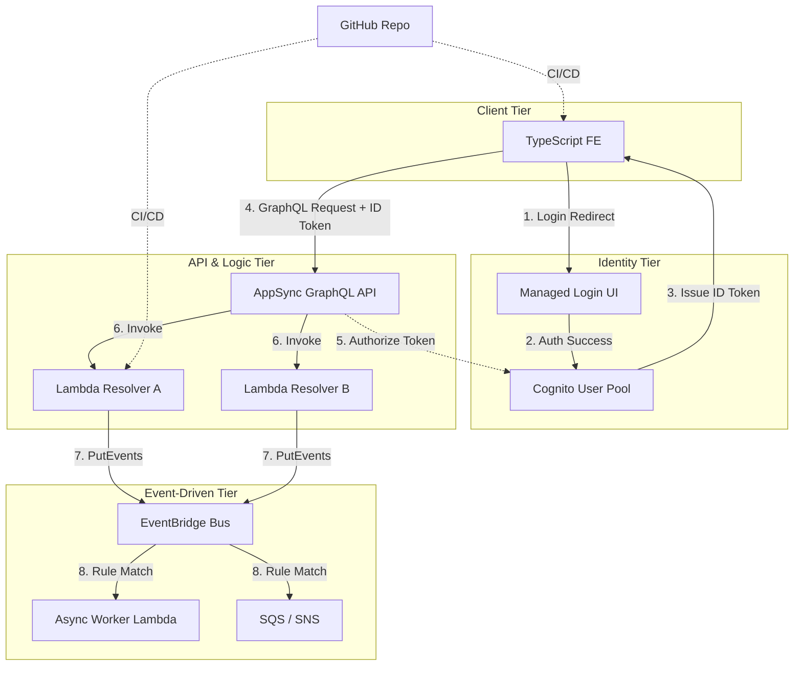

This project involved migrating an application's authentication system from **Auth0** to **Amazon Cognito** to reduce vendor dependency and better align with AWS-native services.

## Scope of the migration

The migration covered mapping existing Auth0 user flows — sign-up, sign-in, session handling, and role-based access control — to Cognito User Pools and Identity Pools. Application code was updated to support AWS Cognito JWT validation and authentication workflows.

## Key challenges

- **Secure user migration** — moving existing users without exposing credentials.
- **Session continuity** — keeping signed-in users signed in across the switch.
- **Zero downtime** — cutting over from Auth0 to Cognito without an outage.

## Architecture

## Outcome

After migration, the system benefited from improved AWS integration, reduced third-party dependency, and centralized identity management within the AWS ecosystem.
