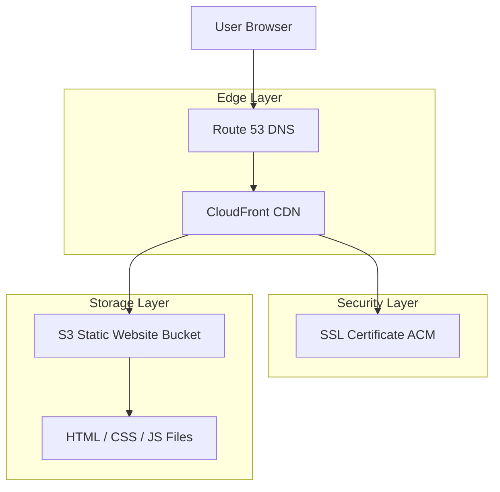

This project demonstrates the deployment of a fully static website using AWS cloud services. The architecture leverages **S3**, **CloudFront**, **Route 53**, and **ACM**.

The goal of this setup was to achieve a secure, scalable, and highly available static website with low-latency access from anywhere in the world.

## Architecture



## Implementation guide

Follow these steps to reproduce this edge-optimized hosting environment.

### 1. Initialize origin storage (S3)

Create an S3 bucket and disable all public access. The bucket will act as the private origin for the distribution.

```bash
aws s3api create-bucket --bucket my-secure-web-bucket --region us-east-1
```

### 2. Establish identity (ACM)

Request a public SSL/TLS certificate. **Important:** you must request this in the `us-east-1` region to ensure CloudFront compatibility.

### 3. Configure CloudFront with OAC

Deploy the distribution. Instead of legacy OAI, use **Origin Access Control (OAC)** for enhanced security and support for encrypted buckets.

```hcl
resource "aws_cloudfront_distribution" "s3_distribution" {
  enabled             = true
  default_root_object = "index.html"

  origin {
    domain_name              = aws_s3_bucket.b.bucket_regional_domain_name
    origin_access_control_id = aws_cloudfront_origin_access_control.default.id
  }
}
```

### 4. Update DNS records (Route 53)

Map your custom domain to the CloudFront distribution using an **Alias A record**. This allows apex domain mapping, which standard CNAMEs do not support.

### 5. Handshake permissions

Apply the S3 bucket policy to allow the CloudFront service principal to fetch objects. This completes the "zero trust" link between your CDN and storage.

### 6. Cache management

Execute a manual invalidation after the initial deployment to ensure the global edge nodes are synchronized with your latest build.

```bash
aws cloudfront create-invalidation --distribution-id YOUR_ID --paths "/*"
```

## Architectural challenges

> **Regional constraints:** certificates must reside in `us-east-1` for global distributions, regardless of where your other resources sit.
>
> **Consistency vs. performance:** high TTLs improve cache hit ratios but require explicit invalidation logic during CI/CD cycles.
>
> **OAC policy logic:** the S3 bucket policy must specifically reference the distribution ARN to prevent unauthorized access from other CloudFront users.
