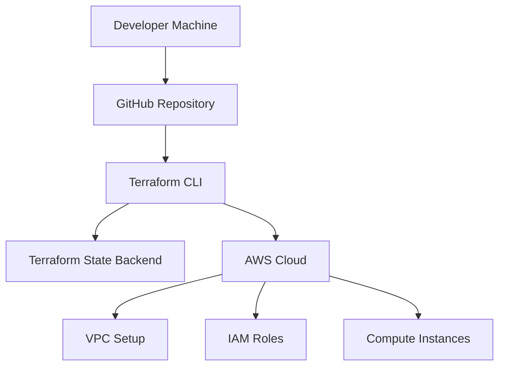

This project focuses on automating AWS infrastructure provisioning using Terraform. The goal was to implement Infrastructure-as-Code (IaC) to ensure consistent, repeatable, and version-controlled cloud deployments.

Instead of manually creating resources in AWS, Terraform is used to define infrastructure declaratively, allowing environments to be created, modified, and destroyed reliably.

## Architecture

## Implementation details

The infrastructure was defined using Terraform configuration files, including VPC, subnets, IAM roles, and compute resources.

Terraform state was managed remotely to ensure collaboration and consistency across environments.

CI/CD integration with GitHub allows infrastructure changes to be version-controlled and automatically applied.

## Key benefits

- Infrastructure-as-Code (IaC) for consistency
- Automated provisioning of AWS resources
- Version-controlled infrastructure changes via GitHub
- Reduced manual errors and faster deployments
